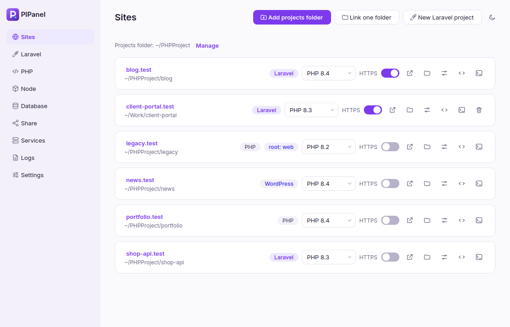
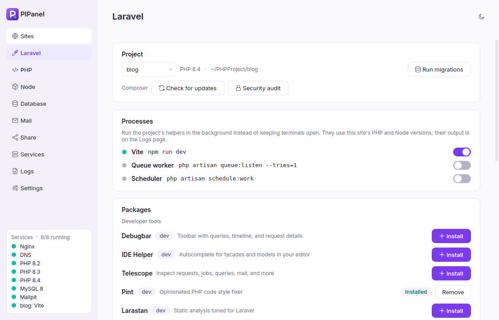
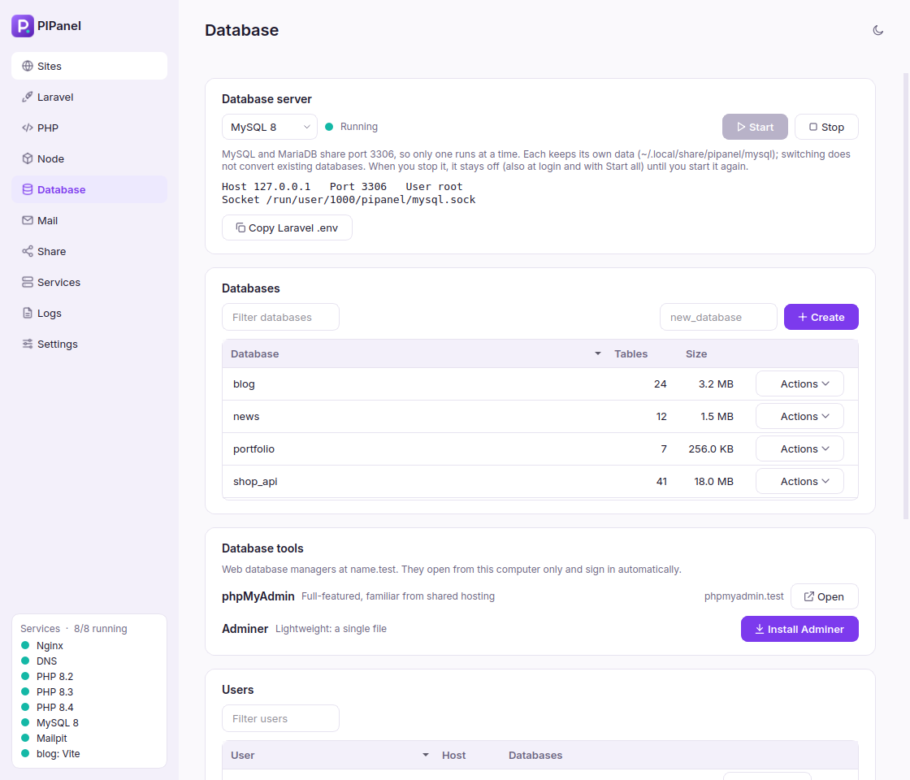
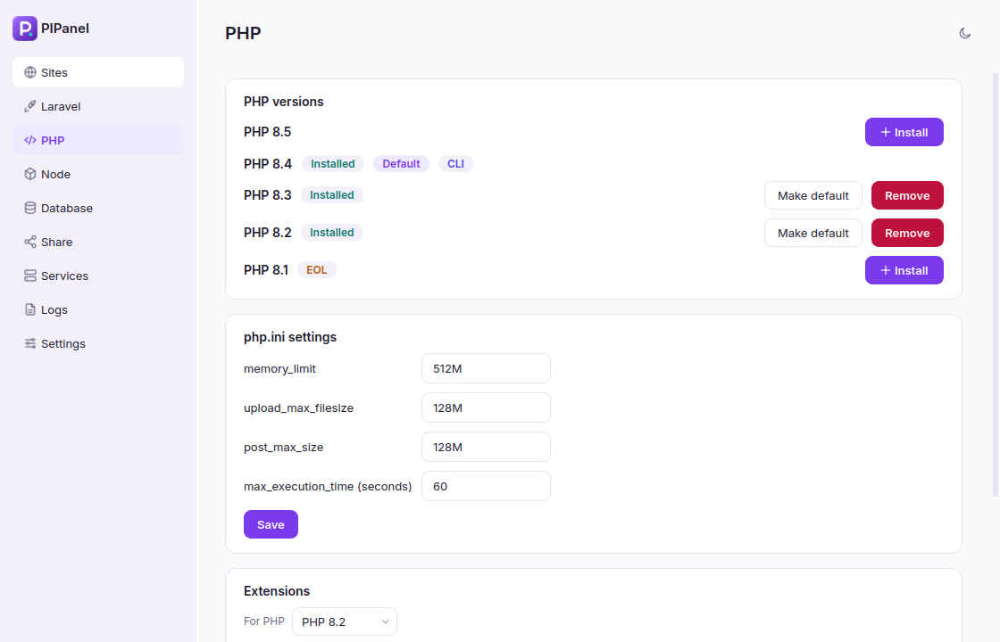
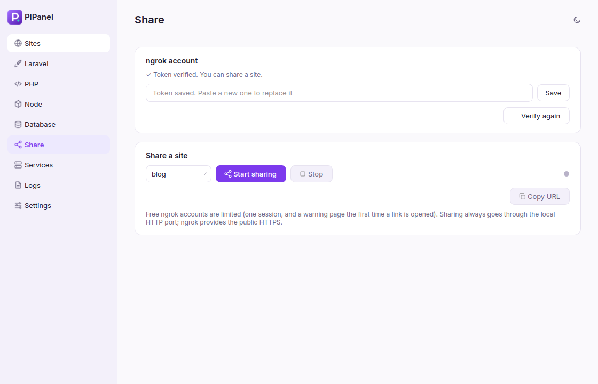
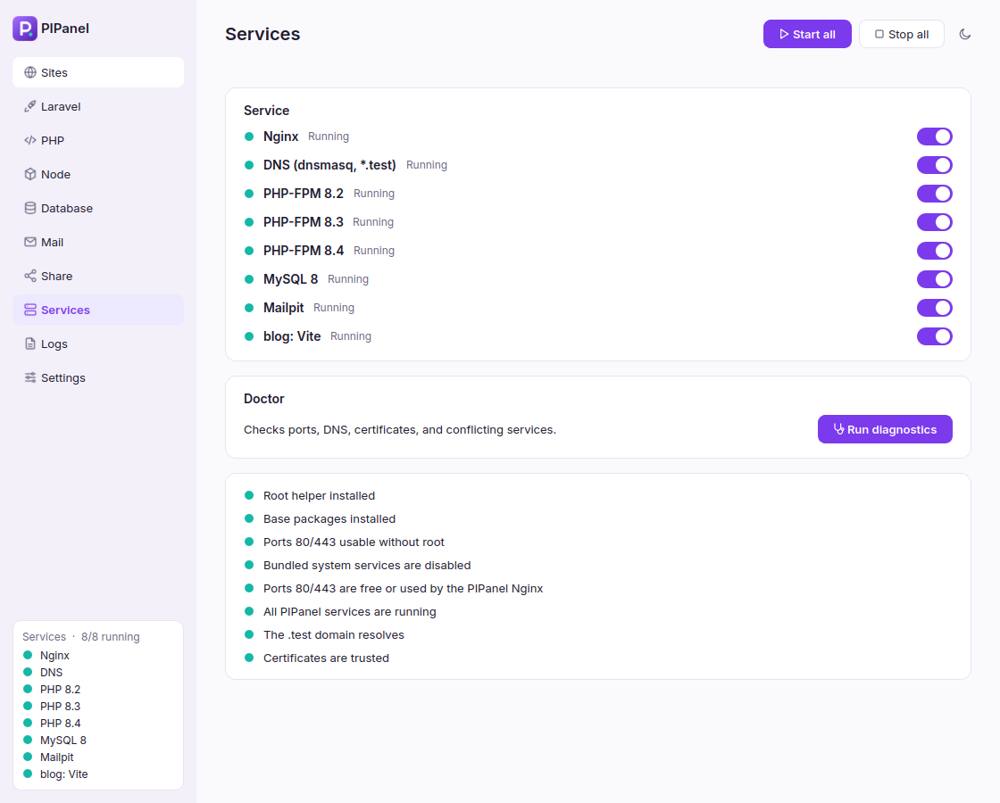
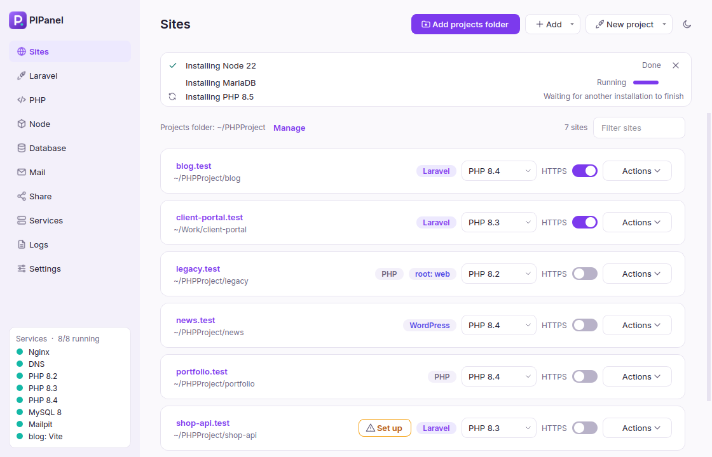
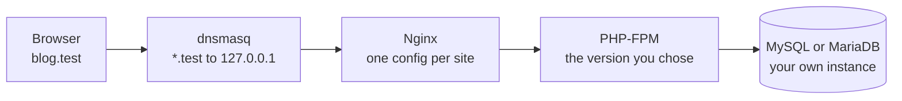

<p align="center">
  
</p>

<h1 align="center">PIPanel</h1>

<p align="center">
  <b>Local PHP development for Linux, without Docker.</b><br>
  Nginx, several PHP versions, MySQL or MariaDB, trusted HTTPS and <code>*.test</code> domains,<br>
  controlled from one calm desktop app.
</p>

<p align="center">
  
  
  
  
</p>

<p align="center">
  <a href="https://pahrulirfan.github.io/PHP-DevTools/"><b>Documentation</b></a> ·
  <a href="#quick-start">Quick start</a> ·
  <a href="#features">Features</a> ·
  <a href="#faq">FAQ</a>
</p>

<p align="center">
  <picture>
    <source media="(prefers-color-scheme: dark)" srcset="docs/assets/img/dark-sites.png">
    
  </picture>
</p>

## Why PIPanel

Laravel Herd and Laragon made local PHP development pleasant on macOS and Windows. PIPanel brings that experience
to Linux Mint and Ubuntu, using the real Nginx, PHP-FPM and database packages instead of containers:

- **Drop a project in a folder and it is live** at `project-name.test`, with the PHP version you choose.
- **No Docker, no daily `sudo`.** Everything runs as your own user through `systemctl --user`, so it keeps
  running when you close the window.
- **Nothing hidden.** Plain config files in your home folder, plain systemd units, plain logs.

## Features

| | |
|---|---|
| **Sites** | A projects folder turns every subfolder into `name.test`. Link single folders, pick the PHP version and web root per site, open it in the browser, file manager, VS Code or a terminal. |
| **PHP** | Install PHP 8.2 to 8.5 side by side. Choose the default `php` for your terminal. Edit `php.ini` values and toggle extensions (Laravel-required ones are marked), all without touching `/etc/php`. |
| **Laravel** | Create a project with its database and `.env` ready and migrations run. Install packages (Debugbar, Telescope, Livewire, Pest, ...) or any Packagist package, using the site's own PHP version. |
| **Database** | **MySQL 8 or MariaDB**, to match your production server. Databases, users, root password, and a one-click Laravel `.env` snippet. |
| **HTTPS** | One toggle per site for a certificate your browser trusts (mkcert). Optional: everything also works over plain `http://`. |
| **Node.js** | Install and switch Node versions with fnm, with automatic switching on `.node-version` / `.nvmrc`. |
| **Share** | Publish a site with ngrok. The panel verifies your token with ngrok before enabling the button. |
| **Services and Doctor** | Start and stop every service. Diagnostics explain what is wrong, such as which program holds port 80. |
| **Background tasks** | Installs run in the background; every task stays visible with its result. `apt` jobs queue, everything else runs in parallel. |
| **Themes** | Light, dark, or follow the system. |

## Screenshots

<table>
  <tr>
    <td width="50%"><picture><source media="(prefers-color-scheme: dark)" srcset="docs/assets/img/dark-laravel.png"></picture><br><sub><b>Laravel</b>: install packages with the site's PHP version</sub></td>
    <td width="50%"><picture><source media="(prefers-color-scheme: dark)" srcset="docs/assets/img/dark-database.png"></picture><br><sub><b>Database</b>: MySQL 8 or MariaDB</sub></td>
  </tr>
  <tr>
    <td><picture><source media="(prefers-color-scheme: dark)" srcset="docs/assets/img/dark-php.png"></picture><br><sub><b>PHP</b>: versions, php.ini, extensions</sub></td>
    <td><picture><source media="(prefers-color-scheme: dark)" srcset="docs/assets/img/dark-share.png"></picture><br><sub><b>Share</b>: verified ngrok token, one click</sub></td>
  </tr>
  <tr>
    <td><picture><source media="(prefers-color-scheme: dark)" srcset="docs/assets/img/dark-services-doctor.png"></picture><br><sub><b>Services</b> and <b>Doctor</b></sub></td>
    <td><picture><source media="(prefers-color-scheme: dark)" srcset="docs/assets/img/dark-activity.png"></picture><br><sub><b>Tasks</b>: nothing gets lost</sub></td>
  </tr>
</table>

## Quick start

```bash
sudo apt install -y git python3-venv python3-pip libxcb-cursor0
git clone https://github.com/pahrulirfan/PHP-DevTools.git
cd PHP-DevTools
./install.sh
```

Then open **PIPanel** from your application menu and click **Run setup** (one password dialog). After that,
click **Add projects folder**, choose the folder that holds your projects, and open
`http://<project-name>.test`.

`install.sh` asks for `sudo` once, only to install a small root-owned helper. See
[what runs as root](#security).

<details>
<summary>What does setup do?</summary>

- adds the `ondrej/php` repository and installs Nginx, dnsmasq, mkcert and PHP with the extensions Laravel needs;
- turns off the system copies of Nginx, MySQL and PHP-FPM so only PIPanel's own instances run;
- lets programs started by your user listen on ports 80 and 443 and routes `*.test` to PIPanel's DNS;
- creates a local certificate authority, installs Composer, writes the systemd user units and starts them.
</details>

## How it works



PIPanel writes the configuration, runs each piece as a `systemd --user` unit, and reports their state. The
Python code in `pipanel/core` never imports Qt, so all of the logic is tested without a display; the UI only
talks to one controller class.

## Security

Only a single helper runs as root, started with `pkexec` (the normal graphical password dialog). It lives in
[`packaging/pipanel-helper`](packaging/pipanel-helper), is owned by root so your user cannot modify it, and
accepts a fixed list of commands (`setup`, `install-php`, `remove-php`, `install-ext`, `install-database`,
`trust-ca`, `untrust-ca`, `disable-system-services`). Every argument is validated, and the user to configure
comes from the system's `PKEXEC_UID`, never from arguments. Nginx, PHP, the database and ngrok all run as you.
The database listens on `127.0.0.1` only.

## FAQ

<details><summary>The browser says "This site can't be reached" (DNS_PROBE_FINISHED_NXDOMAIN)</summary>

PIPanel's DNS or Nginx is not running. Click **Start services** on the Sites page. If it fails, the message
names the cause, most often another program holding port 80 or 443 (for example DDEV's router). Stop it, or
move PIPanel to other ports in **Settings → Web ports**.
</details>

<details><summary>Is mkcert required?</summary>

No. Everything works over `http://`. mkcert only powers the HTTPS toggle (trusted certificates, useful for
secure cookies, OAuth callbacks and service workers). `sudo apt install mkcert`.
</details>

<details><summary>A new Laravel project says the <code>sessions</code> table does not exist</summary>

Run the migrations: **Laravel → Run migrations**. Projects created from PIPanel do this automatically.
</details>

<details><summary>Do I need an ngrok account?</summary>

Yes, ngrok requires one. Save your authtoken on the **Share** page and click **Verify token**; sharing is
enabled once ngrok accepts it.
</details>

<details><summary>MySQL or MariaDB?</summary>

Whichever your production server uses. Both work with Laravel; they keep separate data folders and share
port 3306, so one runs at a time.
</details>

<details><summary>Apache, other distributions, macOS or Windows?</summary>

Not supported. PIPanel uses Nginx (like Herd) and is tested on Linux Mint 22.3. Ubuntu 22.04 and 24.04 are
expected to work.
</details>

More answers are in the [documentation](https://pahrulirfan.github.io/PHP-DevTools/#faq).

## Development

```bash
python3 -m venv .venv && .venv/bin/pip install -e '.[ui,dev]'
.venv/bin/pytest                        # more than 270 tests, no root and no Nginx needed
.venv/bin/python tools/screenshots.py   # re-render the screenshots in docs/assets/img
.venv/bin/python -m pipanel
```

`tools/e2e_*.py` run the real stack without root (Nginx and PHP-FPM over HTTP and HTTPS, MySQL and MariaDB,
Composer, fnm, ngrok checks) under their own systemd unit prefix, so they never touch a real installation.
Design notes and decisions are in [PLAN.md](PLAN.md).

```
pipanel/
├─ core/        logic with no Qt: services, PHP, databases, Laravel, ngrok, Doctor, controller
├─ templates/   Jinja2 templates for Nginx, PHP-FPM, dnsmasq, systemd and database config
├─ ui/          Qt interface: theme, widgets, background tasks, one module per page
└─ assets/      logo and bundled Inter font (SIL Open Font License)
packaging/      root helper, polkit policy, desktop entry
tools/          install helpers, screenshots, real end-to-end checks
tests/          pytest suite
docs/           the documentation site (GitHub Pages)
```

## Status

Tested on Linux Mint 22.3 (Cinnamon). The ngrok failure paths (no token, invalid token) are checked against
ngrok's servers; a successful tunnel needs a real account. Not yet packaged as a `.deb` or AppImage.

## Credits

Built by Pahrul Irfan. UI font [Inter](https://rsms.me/inter/) (SIL Open Font License).
