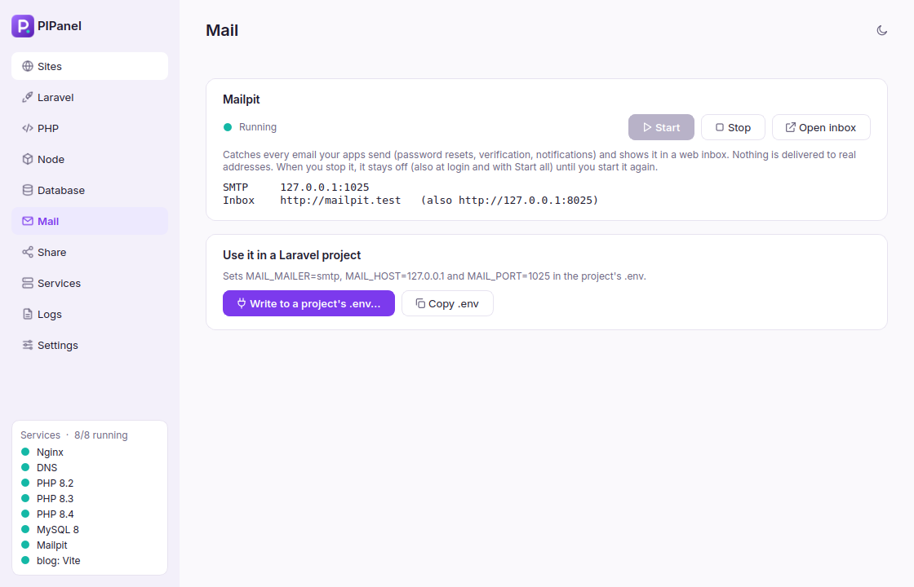
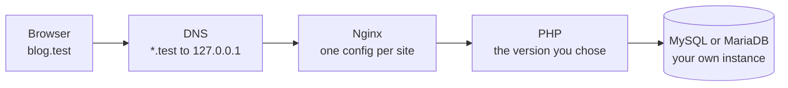

<p align="center">
  
</p>

<h1 align="center">PIPanel</h1>

<p align="center">
  <b>Local PHP development for Linux, Windows and macOS, without Docker.</b><br>
  Nginx, several PHP versions, MySQL or MariaDB, trusted HTTPS and <code>*.test</code> domains,<br>
  controlled from one calm desktop app.
</p>

<p align="center">
  
  
  
  <a href="https://github.com/pahrulirfan/PHP-DevTools/actions/workflows/tests.yml"></a>
</p>

<p align="center">
  <a href="https://pahrulirfan.github.io/PHP-DevTools/"><b>Documentation</b></a> ·
  <a href="#quick-start">Quick start</a> ·
  <a href="#features">Features</a> ·
  <a href="#faq">FAQ</a>
</p>

<p align="center">
  <picture>
    <source media="(prefers-color-scheme: dark)" srcset="docs/assets/img/dark-sites.png">
    
  </picture>
</p>

## Why PIPanel

Laravel Herd and Laragon made local PHP development pleasant, but **neither runs on Linux**: Herd is for macOS
and Windows, Laragon for Windows. PIPanel runs on **all three**, the same app with the same features, using the
real Nginx, PHP and database programs, no containers, and adds things those apps leave to you.

### What PIPanel does that others don't

- **A cloned project runs after one click.** `git clone` into your projects folder: the site appears by itself
  and shows **Set up**, which runs `composer install` with the site's PHP version, creates `.env` and `APP_KEY`,
  creates the database named in `.env`, and **migrates or imports the `.sql` dump shipped in the repository**.
- **Vite, queues and the scheduler without four terminals.** Toggle `npm run dev`, `queue:listen`,
  `schedule:work`, Reverb or Horizon per project; they run as services with the project's own PHP and Node
  versions and their output is in the log viewer.
- **It tells you why something broke.** When a service crashes you get a desktop notification with the reason,
  for example *"port 80 is used by apache2"* or the Docker container holding it, and a **Restart** button.
- **Pro features, free.** The mail inbox (Mailpit), Redis, a log viewer with `laravel.log` level filtering and
  Xdebug are part of Herd Pro, a paid subscription. Here they are included, along with phpMyAdmin and Adminer
  that sign in by themselves, and database backup, import and clone.
- **Share without an account.** A Cloudflare quick tunnel gives a public HTTPS link with no sign-up (ngrok is
  there too).
- **New folders are served at once, even with the app closed.** No reload, no confirmation: `*.test` already
  resolves, and a folder watcher writes the Nginx config within seconds.
- **Only what you use runs.** PHP-FPM runs for the PHP versions your sites use; tools you stop stay stopped.
- **Nothing hidden.** No Docker and no daily administrator password: everything runs as your user (systemd user
  units on Linux, a small background agent on Windows and macOS), as plain config files and plain logs. The only
  code that runs as administrator is one short script you can read.

| | PIPanel | Laravel Herd | Laragon |
|---|---|---|---|
| Linux | **Yes** (Mint, Ubuntu) | No | No |
| Windows | **Yes** | Yes | Yes |
| macOS | **Yes** | Yes | No |
| Mail inbox, Redis, log viewer, Xdebug | **Included** | Herd Pro (paid) | Mail catcher included |
| Set up a cloned project in one click | **Yes** | No | No |
| Background Vite, queue, scheduler per project | **Yes** | No | No |
| Price | **Free, open source** | Free; Pro paid yearly | Free for personal use; paid for commercial use |

<sub>Compared with the public feature lists of Herd and Laragon as of October 2026. Something out of date?
Please open an issue.</sub>

## Features

| | |
|---|---|
| **Sites** | A projects folder turns every subfolder into `name.test`, **as soon as the folder appears** (even with the app closed). Link single folders, proxy a name to another dev server (Vite, Next.js, Go), pick the PHP version and web root per site. One **Actions** menu per site: browser, VS Code, terminal, folder, logs, share. Filter and pages for hundreds of sites. |
| **Cloned projects** | A Laravel project fresh from Git is marked **Set up**: one click runs `composer install`, creates `.env` and `APP_KEY`, creates the database, then migrates or imports a `.sql` dump from the repository. |
| **PHP** | Install PHP 8.2 to 8.5 side by side. In a site folder, `php` and `composer` in the terminal use **that site's version**. Only the versions in use run. Edit `php.ini` values, toggle extensions, and switch **Xdebug** on only while debugging (with a VS Code `launch.json`). |
| **Laravel** | Create a project with its database and `.env` ready. Install packages (Debugbar, Telescope, Livewire, Pest, ...). Run **Vite, the queue worker, the scheduler, Reverb or Horizon** in the background instead of four terminals. `composer outdated` and `composer audit` in one click. |
| **WordPress** | A new site with WP-CLI: WordPress downloaded, its database created, installed, and the admin password shown. |
| **Database** | **MySQL 8 or MariaDB**, to match your production server. A table of databases with size and tables, and an Actions menu each: backup to `.sql.gz`, import, clone, write to a project's `.env`, open in **phpMyAdmin** or **Adminer** (one-click installs that sign in by themselves). Users with their access. |
| **Mail and Redis** | **Mailpit** catches every email at `mailpit.test`. **Redis** for cache, queues and Horizon. Both write their settings into a project's `.env`. |
| **HTTPS** | One toggle per site for a certificate your browser trusts (mkcert); `APP_URL` in `.env` follows. Optional: everything also works over plain `http://`. |
| **Node.js** | Install and switch Node versions with fnm, with automatic switching on `.node-version` / `.nvmrc`. |
| **Share** | A public link with a **Cloudflare quick tunnel** (no account) or ngrok (verified token). |
| **Services and Doctor** | Start and stop every service from the app, the tray menu or the terminal. A **notification with the reason and a Restart button** when a service crashes. Tools you stop stay off until you start them again. Diagnostics explain what is wrong, such as which program holds port 80. |
| **Everywhere** | **Ctrl+K** finds any site or action. The tray menu lists what runs, which sites use each PHP version, and your recent sites. The `pipanel` command does the same from a terminal (`pipanel isolate 8.2`, `pipanel share`, ...). |
| **Logs** | Nginx, PHP-FPM, the database, every background process, and each project's `laravel.log` with a level filter. |
| **Background tasks** | Installs run in the background; every task stays visible with its result. `apt` jobs queue, everything else runs in parallel. |
| **Themes** | Light, dark, or follow the system. |

## Screenshots

<table>
  <tr>
    <td width="50%"><picture><source media="(prefers-color-scheme: dark)" srcset="docs/assets/img/dark-laravel.png"></picture><br><sub><b>Laravel</b>: background processes and packages, with the site's PHP version</sub></td>
    <td width="50%"><picture><source media="(prefers-color-scheme: dark)" srcset="docs/assets/img/dark-database.png"></picture><br><sub><b>Database</b>: MySQL 8 or MariaDB, backups, phpMyAdmin and Adminer</sub></td>
  </tr>
  <tr>
    <td><picture><source media="(prefers-color-scheme: dark)" srcset="docs/assets/img/dark-php.png"></picture><br><sub><b>PHP</b>: versions, php.ini, extensions, Xdebug</sub></td>
    <td><picture><source media="(prefers-color-scheme: dark)" srcset="docs/assets/img/dark-share.png"></picture><br><sub><b>Share</b>: Cloudflare without an account, or ngrok</sub></td>
  </tr>
  <tr>
    <td><picture><source media="(prefers-color-scheme: dark)" srcset="docs/assets/img/dark-services-doctor.png"></picture><br><sub><b>Services</b> and <b>Doctor</b></sub></td>
    <td><picture><source media="(prefers-color-scheme: dark)" srcset="docs/assets/img/dark-mail.png"></picture><br><sub><b>Mail</b>: every email in a local inbox</sub></td>
  </tr>
</table>

## Quick start

Download the package for your system from the [latest release](https://github.com/pahrulirfan/PHP-DevTools/releases/latest),
open **PIPanel**, and click **Run setup** once. Then click **Add projects folder**, choose the folder that holds
your projects, and open `http://<project-name>.test`.

| System | Package | Notes |
|---|---|---|
| **Linux Mint 22, Ubuntu 24.04** | `pipanel_<version>~ubuntu24.04_amd64.deb` | `sudo apt install ./pipanel_*.deb` |
| **Linux Mint 21, Ubuntu 22.04** | `pipanel_<version>~ubuntu22.04_amd64.deb` | same |
| **Windows 10 and 11** (64-bit) | `PIPanel-<version>-windows-x64-setup.exe` | or the portable `.zip` |
| **macOS 12 or newer** | `PIPanel-<version>-macos-apple-silicon.dmg` (or `-intel`) | needs [Homebrew](https://brew.sh) |

<details>
<summary>What does setup do?</summary>

- **Linux:** adds the `ondrej/php` repository and installs Nginx, dnsmasq, mkcert and PHP with the extensions
  Laravel needs; turns off the system copies of Nginx, MySQL and PHP-FPM; lets programs of your user listen on
  ports 80 and 443 and routes `*.test` to PIPanel's DNS (one password dialog).
- **Windows:** downloads Nginx, PHP (windows.php.net, checksum verified) and mkcert into
  `%LOCALAPPDATA%\PIPanel`; one administrator prompt adds a DNS rule for `.test` and trusts the HTTPS
  certificate authority. Nothing else needs administrator rights.
- **macOS:** installs Nginx and PHP with Homebrew (as you); one password dialog creates `/etc/resolver/test` and
  trusts the HTTPS certificate authority.
- Everywhere: creates the certificate authority, installs Composer, puts `php`, `composer` and `pipanel` on your
  terminal's path, and starts the services.
</details>

<details>
<summary>Install from source (Linux)</summary>

```bash
sudo apt install -y git python3-venv python3-pip libxcb-cursor0
git clone https://github.com/pahrulirfan/PHP-DevTools.git
cd PHP-DevTools
./install.sh
```

`install.sh` asks for `sudo` once, only to install the small root-owned helper. After `git pull`, run it again
and reopen the app from the tray menu (Quit, then open it).
</details>

<details>
<summary>The app is not signed</summary>

PIPanel is free and its packages are not signed with a paid certificate. **Windows** SmartScreen may show "Windows
protected your PC": click *More info → Run anyway*. **macOS** says the app "cannot be opened": right-click
PIPanel in Applications, choose *Open*, then *Open* again (once).
</details>

## How it works



PIPanel writes plain configuration files, runs each piece as a service of your own user, and reports their state.
A new project folder gets its Nginx config within seconds even when the app is closed, and PHP runs only for the
versions that sites use.

| | Linux | Windows | macOS |
|---|---|---|---|
| Services | systemd user units | PIPanel's agent (starts at login) | PIPanel's agent (a LaunchAgent) |
| `*.test` | dnsmasq + systemd-resolved | PIPanel's DNS + a Name Resolution Policy rule | PIPanel's DNS + `/etc/resolver/test` |
| PHP | PHP-FPM from `ondrej/php` | php-cgi pools, official windows.php.net builds | PHP-FPM from Homebrew (`shivammathur/php`) |
| Databases, Redis | apt packages | official zip downloads | Homebrew |
| New folders | a systemd path unit | the agent | the agent |
| Files | `~/.config/pipanel`, `~/.local/share/pipanel` | `%LOCALAPPDATA%\PIPanel` | `~/Library/PIPanel` |

The Python code in `pipanel/core` never imports Qt, so all of the logic is tested without a display; the UI only
talks to one controller class.

## Security

**Linux:** only a single helper runs as root, started with `pkexec` (the normal graphical password dialog). It lives in
[`packaging/pipanel-helper`](packaging/pipanel-helper), is owned by root so your user cannot modify it, and
accepts a fixed list of commands (`setup`, `install-php`, `remove-php`, `install-ext`, `install-database`,
`install-redis`, `trust-ca`, `untrust-ca`, `disable-system-services`). PIPanel tells you (Doctor) when the
installed helper is older than the app. Every argument is validated, and the user to configure
comes from the system's `PKEXEC_UID`, never from arguments. Nginx, PHP, the database and ngrok all run as you.


**Windows:** the only administrator step is [`pipanel-helper.ps1`](packaging/windows/pipanel-helper.ps1), installed
with the app in Program Files (only administrators can change it). It adds or removes PIPanel's DNS rule for
`.test` and trusts mkcert's root certificate, and refuses any other certificate. **macOS:** the same two steps
run through the system's password dialog (`/etc/resolver/test` and the System keychain).

Everywhere, Nginx, PHP, the databases and the tunnels run as you. The database, Redis and Mailpit listen on
`127.0.0.1` only; `mailpit.test`, `adminer.test` and `phpmyadmin.test` answer this computer only. On Windows and
macOS, Nginx listens on `127.0.0.1` only, so the sites are not visible to the network.

## FAQ

<details><summary>The browser says "This site can't be reached" (DNS_PROBE_FINISHED_NXDOMAIN)</summary>

PIPanel's DNS or Nginx is not running. Click **Start services** on the Sites page. If it fails, the message
names the cause, most often another program holding port 80 or 443 (for example DDEV's router). Stop it, or
move PIPanel to other ports in **Settings → Web ports**.
</details>

<details><summary>Is mkcert required?</summary>

No. Everything works over `http://`. mkcert only powers the HTTPS toggle (trusted certificates, useful for
secure cookies, OAuth callbacks and service workers). `sudo apt install mkcert`.
</details>

<details><summary>A new Laravel project says the <code>sessions</code> table does not exist</summary>

Run the migrations: **Laravel → Run migrations**. Projects created from PIPanel do this automatically.
</details>

<details><summary>Do I need an ngrok account?</summary>

Yes, ngrok requires one. Save your authtoken on the **Share** page and click **Verify token**; sharing is
enabled once ngrok accepts it.
</details>

<details><summary>I cloned a Laravel project and it shows an error</summary>

A project from Git has no `vendor/` folder and no `.env`. Its site shows **Set up**: click it (or Actions → Set
up the project) to run `composer install`, create `.env` and `APP_KEY`, create the database, and migrate or import
a `.sql` dump that ships with the repository.
</details>

<details><summary>A new project folder does not show up</summary>

New folders are served within seconds by a folder watcher (`pipanel-watch.path`), even with the app closed.
Run `pipanel sync` to do it by hand. The watcher follows the "start at login" setting.
</details>

<details><summary>Why does phpMyAdmin use PHP 8.3?</summary>

phpMyAdmin 5.2 supports PHP up to 8.3, so PIPanel runs it with the newest installed version it supports, whatever
your default is. Adminer works with every version.
</details>

<details><summary>Windows: port 53 or port 80 is already in use</summary>

PIPanel's DNS answers on `127.0.0.1:53`, because the Windows DNS client can only send questions to port 53.
If another program uses it (some VPN clients do), Doctor names it. For port 80, IIS or another web server is the
usual suspect: stop it, or choose other ports in **Settings → Web ports**.
</details>

<details><summary>macOS: does PIPanel need Homebrew?</summary>

Yes. Nginx, PHP, MariaDB/MySQL and Redis come from Homebrew, installed as your user. Install it from
[brew.sh](https://brew.sh) first.
</details>

<details><summary>MySQL or MariaDB?</summary>

Whichever your production server uses. Both work with Laravel; they keep separate data folders and share
port 3306, so one runs at a time.
</details>

<details><summary>Apache, or other Linux distributions?</summary>

Not supported. PIPanel uses Nginx (like Herd). On Linux it supports Ubuntu 22.04 and 24.04 and the Linux Mint
versions based on them.
</details>

More answers are in the [documentation](https://pahrulirfan.github.io/PHP-DevTools/#faq).

## Development

```bash
python3 -m venv .venv && .venv/bin/pip install -e '.[ui,dev]'
.venv/bin/pytest                        # more than 400 tests, no root and no Nginx needed
.venv/bin/python tools/screenshots.py   # re-render the screenshots in docs/assets/img
.venv/bin/python -m pipanel
```

`tools/e2e_*.py` run the real stack without root (Nginx and PHP-FPM over HTTP and HTTPS, MySQL and MariaDB,
Composer, fnm, ngrok checks, proxies, Mailpit, Adminer, phpMyAdmin, background processes, the folder watcher,
and with `E2E_TUNNEL=1` / `E2E_WORDPRESS=1` a Cloudflare tunnel and a WordPress install) under their own systemd
unit prefix, so they never touch a real installation. `tools/e2e_desktop.py` does the same on Windows and macOS
(real downloads or Homebrew, the agent, DNS through the system resolver, two PHP versions, MariaDB, Mailpit,
Redis); GitHub Actions runs it on every push, next to the unit tests on all three systems.

Packages: `packaging/build-deb.sh` (in an Ubuntu container) and `packaging/pyinstaller/pipanel.spec` (Windows,
macOS); pushing a `v*` tag builds and tests all of them and publishes a release.
Design notes and decisions are in [PLAN.md](PLAN.md).

```
pipanel/
├─ cli.py       the `pipanel` terminal command
├─ core/        logic with no Qt: services, PHP, databases, Laravel, tools, tunnels, Doctor, controller
├─ templates/   Jinja2 templates for Nginx, PHP-FPM, dnsmasq, systemd and database config
├─ ui/          Qt interface: theme, widgets, background tasks, one module per page
└─ assets/      logo and bundled Inter font (SIL Open Font License)
packaging/      root helpers (Linux, Windows), .deb build, PyInstaller spec, Windows installer
tools/          install helpers, screenshots, real end-to-end checks
tests/          pytest suite
docs/           the documentation site (GitHub Pages)
```

## Status

Used daily on Linux Mint 22.3 (Cinnamon). Windows and macOS are tested on GitHub's Windows Server and macOS
runners with the real services; they have had less use on real desktops so far, so please report what you find.
Cloudflare quick tunnels are tested end to end; the ngrok failure paths (no token, invalid token) are checked
against ngrok's servers, a successful ngrok tunnel needs a real account. The packages are not code-signed.
PostgreSQL is not supported yet.

## Credits

Built by Pahrul Irfan. UI font [Inter](https://rsms.me/inter/) (SIL Open Font License).
